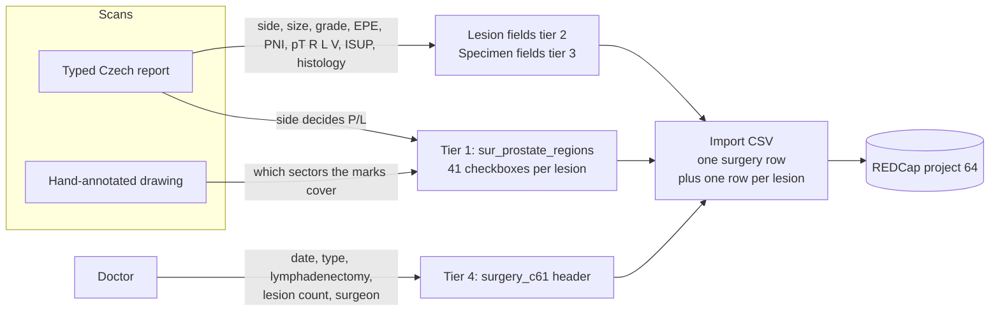
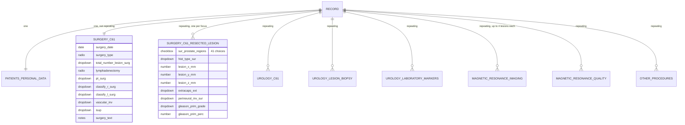
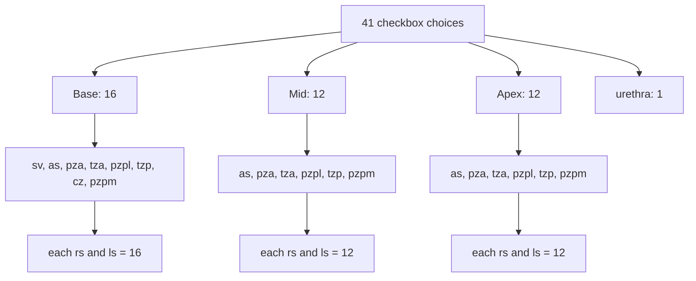
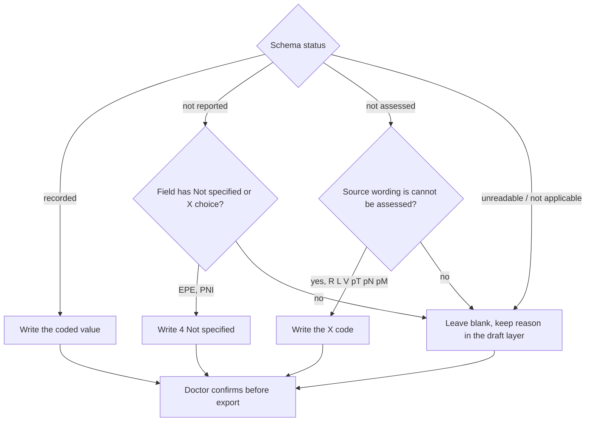
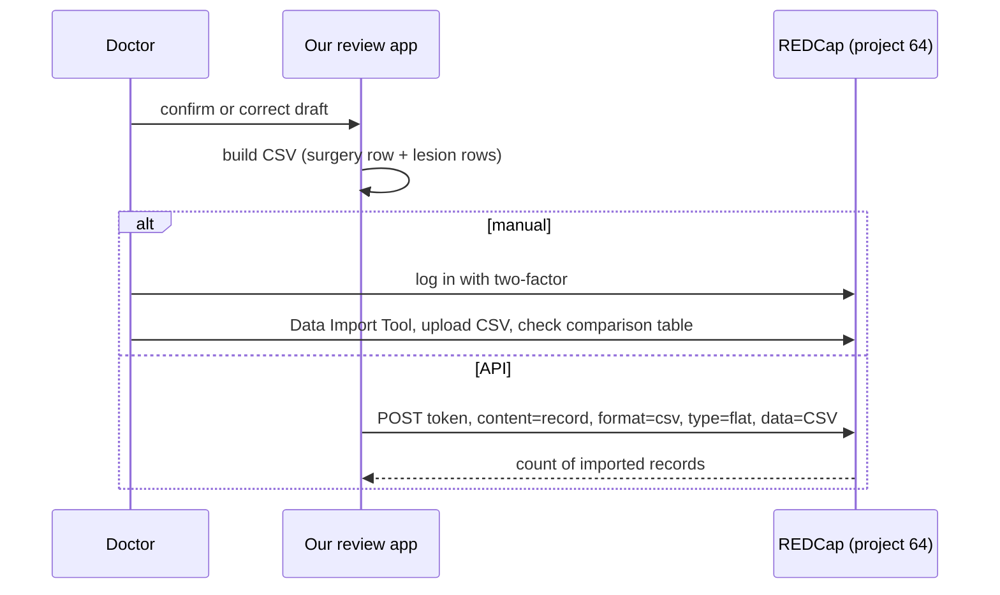

# COMPARE registry in REDCap: what we write and where

Project 64, "COMPARE pro Rakathon", on `https://redcap.mou.cz` (REDCap 17.3.7).
Read from the live project on 2026-10-17 through the logged-in account `rehacekj`. I opened the Codebook, the import and API pages, the Record Status Dashboard (it lists record IDs and form status icons) and one empty lesion form of one record to see the sector map. I saved nothing and imported nothing; no field values of any record were read. Nothing in the project was changed.

Files next to this one:

| File | Content |
|---|---|
| `sector_crosswalk.csv` | The 41 sector checkbox codes, their import column names and the ctsit polygon key for each. |
| `surgery_fields.csv` | Every field of the two surgery instruments plus the patient identity fields: type, choices, required, branching, defaults, proposed source. |
| `example_import.csv` | Synthetic import file: one surgery row and two lesion rows. Header is a working subset of the real template. |
| `handout.html` | One-page cheat sheet. |
| `codebook_raw.txt` | The full Codebook page text, all 9 instruments (80 KB). Source for everything here. |
| `import_template_header.csv` | The Data Import Tool's blank template, 553 column names. |
| `redcap_areas.json` | The 40 sector `<area>` boxes read from the live form, in the 513 × 631 frame. Urethra (a circle) is added by hand in the script. |
| `gen_redcap_docs.py`, `gen_handout.py` | Rebuild the crosswalk, field list, example import and handout offline: `python3 -I gen_redcap_docs.py && python3 -I gen_handout.py`. They read `Other/reference/sectors.json`. |

> **Public repo.** `github.com/jinrehacek/Rakathon26` is public. `image_01_reference_alignment.md` calls the COMPARE choice list private, and this folder is a copy of it (`codebook_raw.txt`, `import_template_header.csv`, `surgery_fields.csv`, `sector_crosswalk.csv`). It is committed on request. It holds no patient data and no API token. If the project owner (Jan Švancara) objects, remove the folder.

---

## 1. Short version

1. The doctor cares most about **segments**: which of 41 prostate sectors each lesion touches. That is the checkbox field `sur_prostate_regions` on the repeating instrument `surgery_c61_resected_lesion`. It is the only thing the drawing feeds.
2. Everything else comes from the report text, or from the doctor because the report does not carry it (surgery date, type, lymphadenectomy, lesion count, surgeon).
3. REDCap has **no free-text note per lesion**, no per-lesion grade group, no per-lesion margin, and no place for a handwritten size note. Anything we extract beyond the fields below has nowhere to go except `surgery_text` at specimen level.
4. Three fields on the lesion form are required and have no blank option that means "not reported": `hist_type_sur`, `extracaps_ext`, `perineural_inv_sur`. The last two have "Not specified".
5. The sector codes are known now. All 41 are checked against the live form. The only difference from our earlier guess is `as_` (not `afs_`) for the anterior fibromuscular stroma.
6. You can push data without the web login: the Data Import Tool takes a CSV, and the API page shows you already hold a token for this project (I did not read it).



---

## 2. Project facts

Verified means I saw it in the live project on 2026-10-17.

| Fact | Value | How |
|---|---|---|
| Server, version | `redcap.mou.cz`, REDCap 17.3.7 | Page footer |
| Project | "COMPARE pro Rakathon", PID 64 | Page header |
| Status | **Development**. The import page warns: real data must not be entered until Production. | Project home, import page |
| Created | 2026-10-13 | Project home |
| Users | 9, none expiring (Bojnanský, Huťan, Kuchtak, Řeháček, Šipoš, Standara, Švancara, Titov, Veselko) | Project home |
| Records | 20 at check time. Record ID looks like `CMP-0000007`; the dashboard and form header also show a 10-character code in brackets, probably the secondary ID (likely `subject_id`, not confirmed). | Record Status Dashboard |
| Structure | Classic project, one arm, one event (event id 112). The import template has no `redcap_event_name` column. | Template header |
| Repeating instruments | Everything except `patients_personal_data` and `surgery_c61`. | `rc-form-repeating` marker on the dashboard |
| Surgery data present | Only 2 of 20 records have a lesion instance; 19 of 20 `surgery_c61` forms are red (incomplete). | Dashboard icons |
| Your access | Codebook, Data Import Tool, API page, Record Status Dashboard, data entry: yes. Online Designer, Define Events, User Rights: access denied. Project Setup redirected to Project Home. Data dictionary download: returned an HTML page, not a CSV. | Page fetches |
| API | The API page lists a token for your account. I did not open or copy it. | API page |
| Sector image | The form loads `github.com/ctsit/imagemap/.../pirads_v2.1.png` in your browser, 513 × 631 px, drawn at 759 px wide, with 41 `<area>` elements whose `data-key` is the REDCap code. | DOM of the lesion form |

Because you cannot download the dictionary, the field tables here come from the Codebook page. Hidden fields and action tags are shown there, so they are complete.

### Data model



The first three instruments (patient, urology C61, biopsy) are not our target. MRI, MRI quality, labs and other procedures are listed in section 9 for completeness.

---

## 3. What matters, in order

| Tier | What | Fields | Source | Why this rank |
|---|---|---|---|---|
| 1 | **Segments** | `sur_prostate_regions___*` (41), `all_sgm___1` | Drawing for position, report for side | The doctor's stated priority. Also the only part the text cannot give. |
| 2 | Lesion properties | `hist_type_sur`, `lesion_x/y/z_mm`, `extracaps_ext`, `perineural_inv_sur`, `gleason_*_grade`, `gleason_*_perc` | Report | Per focus, needed to make a lesion row meaningful. |
| 3 | Specimen classification | `pt_surg`, `pn_surg`, `pm_surg`, `classify_r_surg`, `classify_l_surg`, `vascular_inv`, `isup`, `histol_post_surg(_specify)`, `node_no_surgery`, `node_positive_no_surgery`, `surgery_text` | Report classification line and text | Once per surgery. |
| 4 | Surgery header | `surgery_date`, `surgery_type`, `lymphadenectomy`, `total_number_lesion_surg`, surgeon, pathologist | Doctor | Not in the reports we checked. |
| 0 | Identity | `record_id`, `name`, `surname`, `birth_id` | Report header in production | Needed to find or create the record. Hackathon scans are anonymised. |
| 5 | Workflow | `*_complete` | Us | We should mark machine drafts "Unverified" (1), never "Complete" (2). |

---

## 4. Segments: the 41 sectors

### Structure

Sector code = `zone_level_side`. `rs` is patient right, `ls` is patient left. The urethra is a single code.



| Zone | Meaning | Base | Mid | Apex |
|---|---|:-:|:-:|:-:|
| `sv` | Seminal vesicle | x | | |
| `as` | Anterior fibromuscular stroma (printed "AFS" on the drawing) | x | x | x |
| `pza` | Peripheral zone, anterior | x | x | x |
| `pzpl` | Peripheral zone, posterolateral | x | x | x |
| `pzpm` | Peripheral zone, posteromedial | x | x | x |
| `tza` | Transition zone, anterior | x | x | x |
| `tzp` | Transition zone, posterior | x | x | x |
| `cz` | Central zone | x | | |

So: no central zone and no seminal vesicle below base, and nothing for the coronal or sagittal views. Those two views carry no sector codes; they can only support level and side as evidence.

Full code list with import column names and ctsit keys: `sector_crosswalk.csv`.

### Verified against the live form

I took the 41 `<area>` elements from the lesion form, scaled them back to the 513 × 631 image frame and matched each to the nearest ctsit polygon in `Other/reference/sectors.json` by bounding box. The match is one-to-one: 40 sector codes to keys 1 to 40, `urethra` to key 41. The largest summed corner offset is 22 px (`pzpm_base_ls`). That is the REDCap form's own copy of the polygons, slightly simplified, not an error in the pairing. Urethra is a circle of radius 9 at (414, 594); the ctsit polygon 41 spans (404–422, 586–602).

Consequences for the existing notes:

| Where | Says | Reality |
|---|---|---|
| `Other/research/image_01_reference_alignment.md` crosswalk | `afs_base_rs`, etc. | `as_base_rs`, etc. |
| Same file | key 1 and 2 seminal vesicle level is an inference (`‡`) | The REDCap code is `sv_base_*`, so base is confirmed |
| Same file, `†` marks | codes unverified | verified apart from `afs` → `as` |
| `Other/reference/sectors.json` | `redcap_code_mapping`: unverified, not included | now available in `sector_crosswalk.csv` |
| `Other/IMAGE_PIPELINE.md` | key 41 "check it" | key 41 = `urethra`, same structure |

I have not edited those files.

### Side convention in the form

In the form, `rs` sectors are on the **viewer's left** of each axial view and `ls` on the right. This matches the axial convention on our sheets (patient right on the viewer's left). The form header over the axial views reads "RIGHT SIDE … LEFT SIDE" in that order.

### How the web form behaves (and why import differs)

- `sur_prostate_regions` is `@HIDDEN`. You click the image map; the checkboxes toggle underneath.
- `all_sgm___1` ("All segments affected") is a shortcut. The hidden calc `sgm_affected` = number of ticked sectors (urethra not counted) + `((all_sgm+1)*100)`. When it equals exactly 200, an action tag sets all 40 non-urethra sectors. When it is above 200 and below 240 (all_sgm ticked plus some sectors), another tag clears `all_sgm`.
- The form text says to press **Save & stay** to see the result of the shortcut.
- Those action tags run in the browser form. I have not checked whether they or the calc run on import. **Write all 41 sector columns explicitly and leave `all_sgm___1` at 0.**
- One lesion instance holds one set of sectors. There is no per-sector note, side-specific note or percentage.
- Sectors on both sides in one instance are allowed by the form (`sgm_affected` handles it). Whether the registry wants one instance per side or per focus is a registry convention, not enforced.

---

## 5. Field reference: `surgery_c61` (one per surgery)

Full detail in `surgery_fields.csv`.

| Field | Label | Type and choices | Required | Notes |
|---|---|---|:-:|---|
| `surgery_date` | Date of surgery | date, DMY, 1900-01-01 to today | yes | Doctor. |
| `surgery_type` | Type of surgery | 1 Open surgery, 2 RALP | yes | Doctor. |
| `total_number_lesion_surg` | Total number of operated lesions | 1 to 6, 7 Other | yes | Doctor. `…_oth` (integer 0–100) shows when 7. |
| `lymphadenectomy` | Lymphadenectomy | 1 Performed, 2 Not performed | yes | Doctor. 1 reveals the two node counts. |
| `surgeon_query`, `pathologist_query` | autocomplete (SQL) | server-side list | no | `…_other` text shows when the value is `Other`. |
| `surgery_text` | Histological finding | free text | no | The only free text in the surgery part. |
| `pt_surg` | pT | 1 pT0, 2 pT1a, 3 pT1b, 4 pT1c, 5 pT2a, 6 pT2b, 7 pT2c, 8 pT3a, 9 pT3b, 10 pT4, 11 pTX | no | |
| `pn_surg` | pN | 1 pN0, 2 pN1, 3 pNX | no | Form default 1. |
| `pm_surg` | pM | 1 pM0, 2 pM1a, 3 pM1b, 4 pM1c, 5 pMX | no | Form default 5. |
| `node_no_surgery` | Resected nodes | integer 0–20 | yes if lymphadenectomy = 1 | |
| `node_positive_no_surgery` | Positive nodes | integer 0 to `node_no_surgery` | yes if lymphadenectomy = 1 | |
| `classify_r_surg` | R | 1 R0, 2 R1, 3 R2, 4 RX | yes | |
| `classify_l_surg` | L | 1 L0, 2 L1, 3 LX | yes | |
| `vascular_inv` | V | 1 V0, 2 V1, 3 V2, 4 VX | yes | |
| `isup` | Grade group | 1 to 5 | no | Specimen level only. |
| `histol_post_surg` | Definitive histology | 1 Carcinoma/epithelial, 2 Neuroendocrine, 3 Sarcoma, 4 Hematolymphoid, 5 Metastasis, 6 Other malignant | yes | Form default 1. |
| `histol_post_surg_specify` | ICD-O specification | autocomplete, ontology MKN-O 3.2 (CZ) | no | Form default `81403 Adenokarcinom, NS`. |

The TNM block has an attached help PDF, `COMPARE_TNM_klasifikace.pdf`, shown inline on the Surgery C61 data entry page. I did not get it: the Codebook has no link to it. It is probably the registry's own guide to coding pT, R, L and V; open it from that page when you next log in.

## 6. Field reference: `surgery_c61_resected_lesion` (one per focus)

| Field | Label | Type and choices | Required | Notes |
|---|---|---|:-:|---|
| `all_sgm___1` | All segments affected | checkbox | no | See section 4. |
| `sur_prostate_regions___<code>` | Prostate regions | 41 checkboxes, 1 or 0 | no | Tier 1. |
| `hist_type_sur` | Type of histology | 1 Benign, 2 Carcinoma, 3 Neuroendocrine, 4 Sarcoma, 5 Haematolymphoid, 6 Metastasis, 7 Other malignant | **yes** | Form default 2. |
| `lesion_x_mm`, `lesion_y_mm`, `lesion_z_mm` | Dimensions | number 0–100 mm | no | The form does not say which axis is which. |
| `extracaps_ext` | Extraprostatic extension | 1 Yes, 2 Uncertain, 3 No, 4 Not specified | **yes** | |
| `perineural_inv_sur` | Perineural invasion | 1 Yes, 2 Uncertain, 3 No, 4 Not specified | **yes** | |
| `gleason_prim_grade` / `_perc` | Primary pattern, % | 1–5, 0–100 | no | |
| `gleason_sec_grade` / `_perc` | Secondary pattern, % | 1–5, 0–100 | no | |
| `gleason_tert_grade` / `_perc` | Tertiary pattern, % | 1–5, 0–100 | no | |

Not in the instrument: lesion label or number, dominant-focus flag, grade group per lesion, total Gleason score, margin per lesion, seminal vesicle invasion as a separate flag, free-text comment, the percentage denominator. `STRUCTURE.md` can represent all of these; REDCap cannot take them.

---

## 7. From `STRUCTURE.md` statuses to REDCap values

The schema distinguishes recorded, not reported, unreadable, not assessed and not applicable. REDCap mostly has one blank. Mapping at export time:

| Schema state | Fields with an explicit "unknown" choice | Fields without one |
|---|---|---|
| Recorded, present | Yes (1) | value |
| Recorded, absent (explicit negative) | No (3) | value (R0, L0, V0 are code 1 in their dropdowns) |
| Recorded, indeterminate | Uncertain (2) | not available |
| Not reported | `extracaps_ext`, `perineural_inv_sur`: **Not specified (4)** | leave blank. `hist_type_sur` default 2 is a form default, not a rule; a required blank must be filled by the doctor. |
| Not assessed (source says so) | `RX`, `LX`, `VX`, `pTX`, `pNX`, `pMX` when the report says cannot be assessed | blank |
| Unreadable, not applicable | blank | blank |



Losses to tell the doctor about: for R, L and V, "not reported" becomes a blank while "cannot be assessed" becomes the X code, but R, L and V are required, so a blank blocks the form until someone fills it. Unreadable, not applicable and not reported all collapse into blank. Keep the full status in our draft layer; REDCap only gets the reduced value.

Inferred and calculated values (for example a side inferred from mark position, or a total derived from patterns) must stay in the review queue and enter the CSV only after the doctor accepts them. REDCap cannot mark a value as inferred.

---

## 8. What the scans can supply

| REDCap target | Report | Drawing | Doctor |
|---|:-:|:-:|:-:|
| Sectors (tier 1) | side, sometimes zone and level | marks, level, zone | resolves conflicts |
| Lesion dimensions | yes | handwritten note only, never a field value | resolves conflicts |
| Gleason patterns and % | yes | no | |
| EPE, PNI | yes | no | |
| pT, R, L, V, ISUP | yes (classification line) | no | |
| pN, pM, node counts | sometimes | no | |
| Surgery date, type, lymphadenectomy | not in any checked report | no | **yes** |
| Lesion count | partial | marks are not lesions | yes |
| Surgeon, pathologist | unverified | no | yes |
| Benign findings (inflammation, "zánět") | described | marked | **decides** (see section 11) |

---

## 9. The rest of project 64

Not part of our output; listed so nobody has to look again.

| Instrument | Repeating | What it holds |
|---|:-:|---|
| `patients_personal_data` | no | name, surname, `birth_id` (10 chars, no slash), first MRI number, date of birth (computed from `birth_id`), informed consent, `subject_id` |
| `urology_c61` | yes | examination and biopsy done flags, family history, BRCA1/2, DRE, cT, treatment, NCCN risk, ERSPC, Kattan, biopsy summary (date, samples, indication, final histology) |
| `urology_lesion_biopsy` | yes | per-biopsy localisation: same 41-sector map under `uro_prostate_regions`, "mark all right/left" shortcuts, histology, core length, Gleason |
| `urology_laboratory_markers` | yes | PSA, fPSA, PHI and dates |
| `magnetic_resonance_imaging` | yes | exam data, prostate dimensions and volume, up to 4 lesions each with its own 41-sector map (`mri_prostate_regions_1` to `_4`), PI-RADS, ADC, capsule contact, nodes, metastases, cTNM |
| `magnetic_resonance_quality` | yes | sequence and quality ratings |
| `other_procedures` | yes | radiotherapy, PET, other clinical events |

The same sector map is used in urology biopsy, MRI and surgery. Six checkbox fields carry the identical 41 codes (`uro_prostate_regions`, `mri_prostate_regions_1` to `_4`, `sur_prostate_regions`), so one crosswalk serves them all.

---

## 10. Getting data in

### CSV layout

One file, one row per instance. Columns follow the Data Import Tool's own template (553 columns for this project; unused columns can be dropped, but names must match exactly).

| Row | `record_id` | `redcap_repeat_instrument` | `redcap_repeat_instance` | Other columns |
|---|---|---|---|---|
| Surgery | the record | blank | blank | `surgery_*`, `pt_surg` … `surgery_c61_complete` |
| Lesion n | the record | `surgery_c61_resected_lesion` | `n`, or `new` | `hist_type_sur` … `sur_prostate_regions___*` |

`example_import.csv` has this shape with synthetic values. Its record ID `TEST-0001` is a placeholder, not a real or reserved ID.

Rules from the import page and the dictionary:

- Dropdown, radio and checkbox cells take the raw code (`2`), not the label.
- Checkbox columns take `1` or `0`.
- Dates are accepted as `YYYY-MM-DD` under either date setting.
- `redcap_repeat_instance` = `new` auto-numbers. **A re-import with `new` adds the lesions again.** For a re-run use explicit instance numbers.
- "Overwrite data with blank values" defaults to No. Blank cells are then ignored, so a blank cannot clear a value that is already there.
- "Auto-number/overwrite record IDs" defaults to No. Keep it No when updating an existing record.
- The import page offers "Display the data comparison table: Yes", which shows the changes before they are saved. Use it.

### Ways in



Why the API matters here: it uses a token instead of the interactive login, so no two-factor prompt per import. Treat the token like a password:

- Keep it in an environment variable or `.env` (git-ignored), never in a file under `Other/redcap/` or in Git.
- The token is tied to your account and this project. Regenerate it if it leaks.
- A hospital deployment would need its own token under the hospital's own accounts (see `TASK.md`, production requirements).

Sketch, token from the environment, not run:

```sh
curl -sS https://redcap.mou.cz/api/ \
  --data-urlencode "token=$REDCAP_TOKEN" \
  -d content=record -d format=csv -d type=flat \
  -d overwriteBehavior=normal -d returnContent=count \
  --data-urlencode "data@reviewed_record.csv"
```

The API route `/api/` is the standard REDCap one; I confirmed the API page exists but did not call the endpoint.

---

## 11. Open questions and unverified points

For the doctor or for Jan Švancara:

1. **Benign findings.** `hist_type_sur` has "Benign". Should inflammation ("zánět") or other non-tumour marks get a lesion instance with Benign, or stay out? `total_number_lesion_surg` says "number of lesions with appropriate form", which does not settle it.
2. **One instance per focus or per side?** The form allows both sides in one instance.
3. **Lesion label.** There is no field to link instance 2 back to "second focus" in the report. Instance order is the only link.
4. **Dimension axes.** x, y, z are not defined in the form. How should a report's "11 × 15 × 8 mm" map?
5. **Specimen vs lesion grade.** Report grade group has one home (`isup`, specimen). Does a per-focus grade group get dropped?
6. **Pathologist and surgeon.** Does the registry want the pathologist from the report signature?
7. **Existing record.** In production, do we update an existing record found by `birth_id`, or create one? How are `CMP-` IDs issued?

Not verified (needs a test import into this Development project, with the owner's OK):

- Whether the `sgm_affected` calc and the `@IF/@SETVALUE` tags run on import.
- Whether import enforces the "Required" flags (the data entry form shows them; I have not tested the import).
- The stored format of `histol_post_surg_specify` (code only or code plus label).
- What the surgeon and pathologist SQL lists contain.
- Whether a lesion row can be imported without a surgery row for the same record.
- Whether a blank `redcap_repeat_instrument` row for `surgery_c61` is accepted as written in the example.

Established from this session:

- The 41 codes and their geometry (section 4).
- Which instruments repeat (section 2).
- Field types, choices, required flags, branching and defaults (sections 5 and 6), read from the Codebook.
- Your account's access (section 2).

---

## 12. Changes made and suggested

Made: this folder with the files listed at the top. The browser tab was moved off the data-entry form to the Codebook.

Suggested, not done: correct `afs_` → `as_` and the `†` notes in `image_01_reference_alignment.md`; fill `redcap_code_mapping` in `Other/reference/sectors.json` from `sector_crosswalk.csv`; add a "Benign finding" rule to the extraction notes once the doctor answers question 1.
